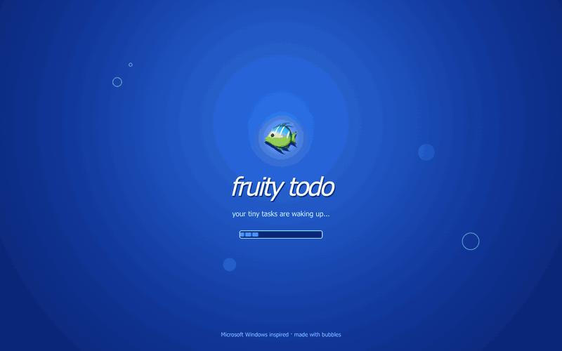

<a id="readme-top"></a>

<!-- PROJECT SHIELDS -->
<div align="center">

![Next.js][Next-badge]
![React][React-badge]
![TypeScript][TS-badge]
![Supabase][Supabase-badge]
![Tailwind CSS][Tailwind-badge]
![Vercel][Vercel-badge]

</div>

<!-- PROJECT LOGO -->
<br />
<div align="center">
  

  <h1 align="center">🐠 Fruity Todo</h1>

  <p align="center">
    Windows XP와 Frutiger Aero 감성으로 만든 회원 전용 Todo 데스크톱
    <br />
    <em>Keep swimming, one task at a time.</em>
    <br />
    <br />
    <a href="https://VERCEL_배포_주소.vercel.app"><strong>🌐 서비스 바로가기 »</strong></a>
    <br />
    <br />
    <a href="#-시연">시연 영상</a>
    &middot;
    <a href="#️-렌더링-전략-서버--클라이언트-컴포넌트">렌더링 전략</a>
    &middot;
    <a href="#-시작하기">로컬 실행</a>
  </p>
</div>

<!-- TABLE OF CONTENTS -->
<details>
  <summary>목차</summary>
  <ol>
    <li><a href="#-프로젝트-소개">프로젝트 소개</a></li>
    <li><a href="#-시연">시연</a></li>
    <li><a href="#-주요-기능">주요 기능</a></li>
    <li><a href="#️-기술-스택">기술 스택</a></li>
    <li><a href="#️-라우팅-구조">라우팅 구조</a></li>
    <li><a href="#️-렌더링-전략-서버--클라이언트-컴포넌트">렌더링 전략</a></li>
    <li><a href="#-상태별-ui">상태별 UI</a></li>
    <li><a href="#-인증--보안">인증 & 보안</a></li>
    <li><a href="#-프로젝트-구조">프로젝트 구조</a></li>
    <li><a href="#-시작하기">시작하기</a></li>
    <li><a href="#-트러블슈팅">트러블슈팅</a></li>
    <li><a href="#️-로드맵">로드맵</a></li>
    <li><a href="#-참고">참고</a></li>
  </ol>
</details>

<br />

## 🐟 프로젝트 소개

이전 React 과정에서 만든 Todo 리스트를 **Next.js 16 (App Router)** 로 마이그레이션하고, **Supabase**로 회원 인증과 데이터 영속성을 붙인 회원 전용 Todo 서비스입니다.

할 일 관리가 지루하지 않도록 화면 전체를 **Windows XP 데스크톱**처럼 꾸몄습니다. 부팅 화면을 지나 XP 스타일 로그인 화면에서 로그인하면, 금붕어가 헤엄치는 바탕화면이 나옵니다. `Todo List` 아이콘을 열면 창 안에서 할 일을 관리할 수 있습니다.

| 부팅 & 로그인 | 데스크톱 | Todo 창 |
| :---: | :---: | :---: |
| 🫧 부팅 로딩 → XP 로그인 화면 | 드래그 가능한 아이콘, 시작 메뉴, 작업 표시줄 | 창 제어 버튼, 메뉴바, 상태 표시줄 |

<p align="right">(<a href="#readme-top">맨 위로</a>)</p>

## 🎬 시연

<div align="center">
  
</div>

> 부팅 → 회원가입(즉시 로그인) → 할 일 등록 → 찜 → 상태 변경 → 찜 목록 → 상세 → 수정 → 삭제 → 로그아웃

<p align="right">(<a href="#readme-top">맨 위로</a>)</p>

## ✨ 주요 기능

- **회원가입 / 로그인 / 로그아웃**: Supabase Auth, 쿠키 기반 세션
- **회원 전용 접근 제어**: 로그인하지 않은 사용자는 `/sign_in?redirectUrl=원래경로`로 이동하고, 로그인하면 원래 페이지로 돌아갑니다.
- **할 일 CRUD**
  - 등록: Tiptap 리치 텍스트 에디터
  - 조회: 준비중 · 진행중 · 완료 3단 보드
  - 상세: 동적 라우트 `/todo/[id]/view`
  - 수정: 등록 폼(`TodoForm`)을 재사용
  - 삭제: `deleted_at`을 기록하는 소프트 삭제
- **낙관적 업데이트**: 상태를 바꾸면 화면에 먼저 반영하고, 서버 요청이 실패하면 원래 상태로 되돌립니다(`useOptimistic`).
- **찜(Pinned) 목록**: zustand + `localStorage`
- **XP 데스크톱 UI**: 부팅 화면, 드래그 가능한 바탕화면 아이콘, 시작 메뉴, 작업 표시줄, 창 최소화·닫기

<p align="right">(<a href="#readme-top">맨 위로</a>)</p>

## 🛠️ 기술 스택

| 구분 | 기술 |
| --- | --- |
| Framework | [Next.js 16](https://nextjs.org) (App Router, Cache Components, Proxy) |
| UI | React 19, Tailwind CSS 4, shadcn/ui, react-icons |
| Language | TypeScript 5 |
| Backend (BaaS) | [Supabase](https://supabase.com) (Auth, PostgreSQL) |
| State | `useState` · `useOptimistic` · `useActionState` · `useTransition`, zustand(+ immer, persist) |
| Editor | Tiptap 3 |
| Deploy | Vercel (GitHub 연동 자동 배포) |

<p align="right">(<a href="#readme-top">맨 위로</a>)</p>

## 🗺️ 라우팅 구조

`(todo)`는 **라우트 그룹**이라 URL에 포함되지 않습니다.

```
app/(todo)/
├── layout.tsx              세션 조회 → WindowsShell(데스크톱 UI)로 감싸기
├── page.tsx                /                  할 일 목록 (3단 보드)
├── loading.tsx             목록 로딩 스켈레톤
├── error.tsx               목록 조회 실패 화면 + 다시 시도
├── sign_in/page.tsx        /sign_in           로그인
├── sign_up/page.tsx        /sign_up           회원가입
└── todo/
    ├── new/page.tsx        /todo/new          할 일 등록
    ├── pin/page.tsx        /todo/pin          찜 목록
    └── [id]/
        ├── not-found.tsx   상세·수정이 함께 쓰는 404 화면
        ├── view/page.tsx   /todo/:id/view     상세 (동적 라우트)
        └── edit/page.tsx   /todo/:id/edit     수정 (동적 라우트)
```

**동적 라우트 파라미터 처리**
- Next.js 16에서는 `params`가 `Promise`라서 `await params`로 `id`를 꺼냅니다.
- 할 일이 없거나, 삭제됐거나, **다른 사용자의 할 일**이면 `notFound()`로 404 화면을 보여줍니다.
- 상세·수정 후에는 `router.replace`로 이동해서, 뒤로 가기를 눌렀을 때 삭제된 페이지로 돌아가지 않게 했습니다.

<p align="right">(<a href="#readme-top">맨 위로</a>)</p>

## ⚙️ 렌더링 전략 (서버 / 클라이언트 컴포넌트)

**원칙: 기본은 서버 컴포넌트로 두고, 상호작용(이벤트, 훅, 브라우저 API)이 필요한 가장 작은 단위만 클라이언트 컴포넌트로 분리합니다.**

| 컴포넌트 | 렌더링 | 이유 |
| --- | --- | --- |
| `(todo)/layout.tsx` | 🟦 Server | 쿠키로 세션을 읽어 사용자 정보를 셸에 props로 전달 |
| `WindowsShell` | 🟧 Client | 부팅 타이머, 아이콘 드래그(Pointer 이벤트), 시작 메뉴·창 열림 상태 |
| `page.tsx` (목록) | 🟦 Server | Supabase에서 목록을 조회해 **데이터가 담긴 HTML**로 첫 화면 전달 |
| `TodoDashBoard` | 🟧 Client | `useOptimistic` + `useTransition`으로 상태 변경을 즉시 반영 |
| `TodoItems` | 🟧 Client | `onClick`, 찜 상태(zustand, `localStorage`) |
| `view/page.tsx`, `TodoDetail` | 🟦 Server | 조회하고 보여주기만 함 → 브라우저로 JS를 보내지 않음 |
| `TodoContentViewer` | 🟧 Client | Tiptap `useEditor` 훅 (읽기 전용) |
| `DeleteTodoButton` | 🟧 Client | `onClick`, `useTransition`, `useRouter`, `confirm` |
| `edit/page.tsx` | 🟦 Server | 기존 데이터 조회 후 폼에 props로 전달 |
| `TodoForm` | 🟧 Client | `useActionState` + 입력 상태, 등록·수정 겸용 |
| `error.tsx` | 🟧 Client | Error Boundary는 클라이언트 컴포넌트여야 함, `retry` 버튼 |
| `loading.tsx`, `not-found.tsx` | 🟦 Server | 정적 UI |

**상세 페이지 예시: 필요한 부분만 클라이언트로**
```
TodoDetail (Server)  ← 제목·상태·작성자·날짜는 서버에서 HTML로 완성
├── TodoContentViewer (Client)  ← 에디터 훅이 필요한 본문만
└── DeleteTodoButton  (Client)  ← 클릭 이벤트가 필요한 버튼만
```

**데이터 페칭 & 성능 고려**
- **서버에서 조회**: 목록·상세·수정 데이터는 서버 컴포넌트에서 조회합니다. 클라이언트에서 `useEffect`로 가져오면 "빈 화면 → 로딩 → 데이터" 순서로 화면이 바뀌는데, 서버에서 조회하면 이 왕복이 없습니다.
- **요청 중복 제거**: `getCurrentUser`를 React `cache()`로 감싸서, 한 요청 안에서 레이아웃·페이지·액션이 여러 번 불러도 Supabase 호출은 1번만 일어납니다.
- **캐시 무효화**: 등록·수정·삭제 서버 액션 끝에서 `revalidatePath`로 목록과 상세 캐시를 갱신합니다.
- **낙관적 UI**: 상태 변경은 서버 응답을 기다리지 않고 바로 화면에 반영하고, 실패하면 자동으로 되돌립니다.
- **스트리밍**: `loading.tsx`로 페이지 영역만 Suspense 처리해서, 셸은 먼저 보이고 목록은 준비되는 대로 채워집니다.
- **Cache Components**: 세션(쿠키)을 읽는 라우트는 정적 셸로 미리 만들 수 없어서 `instant = false`와 `connection()`으로 요청 시점에 렌더링합니다.

<p align="right">(<a href="#readme-top">맨 위로</a>)</p>

## 🚦 상태별 UI

| 상태 | 처리 방식 |
| --- | --- |
| ⏳ 로딩 | `loading.tsx` 스켈레톤, 부팅 화면, 버튼 `isPending` ("삭제 중...", 비활성화) |
| ✅ 성공 | `.map()` 목록 렌더링, `key={item.id}` (상태가 바뀌어 다른 칸으로 이동해도 항목이 섞이지 않음) |
| 🫙 빈 데이터 | 칸별 안내 문구 `EMPTY_MESSAGE: Record<TodoStatus, string>` |
| ❌ 오류 | 조회 실패 시 `throw` → `error.tsx`, 폼 실패 시 `{ success: false }` 반환 → 폼 위 안내 |
| 🔍 없음 | `notFound()` → `[id]/not-found.tsx` |

> 조회 실패를 `[]`로 돌려주면 "할 일이 없습니다"와 구분되지 않습니다. 그래서 조회 실패는 에러로 던지고, 빈 목록과 다른 화면을 보여주도록 분리했습니다.

<p align="right">(<a href="#readme-top">맨 위로</a>)</p>

## 🔐 인증 & 보안

```
요청 → proxy.ts → supabase-proxy.ts
                   ├─ getClaims()로 토큰 검증·갱신
                   ├─ 비로그인 + 보호 경로(/, /todo/*) → /sign_in?redirectUrl=...
                   ├─ 로그인 + /sign_in, /sign_up       → /
                   └─ 리다이렉트할 때 갱신된 세션 쿠키도 함께 전달
```

- Next.js 16에서 `middleware`가 `proxy`로 이름이 바뀌어 `proxy.ts`를 사용합니다.
- proxy에서는 네트워크 요청이 필요한 `getUser()` 대신 **`getClaims()`** (JWT 로컬 검증)를 사용해 모든 요청의 지연을 줄였습니다.
- **권한 확인**: 모든 쿼리와 서버 액션은 `.eq('user_id', user.id)`로 본인 데이터만 다룹니다. 브라우저에서 hidden input의 `id`를 조작해도 다른 사람의 할 일은 수정·삭제할 수 없습니다.
- **XSS 방지**: 에디터 HTML을 `dangerouslySetInnerHTML`로 넣지 않고, Tiptap 스키마를 거쳐 렌더링합니다.
- **에러 메시지 노출 방지**: 사용자에게는 고정 문구만 보여주고, 상세 원인은 서버 로그에만 남깁니다.

<p align="right">(<a href="#readme-top">맨 위로</a>)</p>

## 📁 프로젝트 구조

기능(도메인) 단위로 폴더를 나눴습니다.

```
├── app/                    라우트 (페이지·레이아웃·특수 파일)
├── domains/
│   ├── auth/               actions · components · queries · types · utils
│   └── todo/
│       ├── actions/        서버 액션 (add · update · changeStatus · delete)
│       ├── components/     TodoDashBoard · TodoItems · TodoDetail · TodoForm ...
│       ├── constants/      TODO_STATUS_MAP (서버·클라이언트 공용)
│       ├── queries/        getTodos · getTodoById
│       ├── stores/         usePinStore (zustand)
│       ├── types/ utils/
├── shared/
│   ├── components/         WindowsShell · TiptabEditor · ui/
│   └── lib/                supabase 클라이언트 · supabase-proxy
└── proxy.ts
```

<p align="right">(<a href="#readme-top">맨 위로</a>)</p>

## 🚀 시작하기

### 사전 준비
- Node.js 20 이상
- Supabase 프로젝트

### 설치

1. 저장소 클론
   ```sh
   git clone https://github.com/mjlee0914/react-todolist.git
   cd react-todolist
   ```
2. 패키지 설치
   ```sh
   npm install
   ```
3. 프로젝트 루트에 `.env.local` 작성
   ```env
   NEXT_PUBLIC_SUPABASE_URL=https://xxxx.supabase.co
   NEXT_PUBLIC_SUPABASE_PUBLISHABLE_KEY=sb_publishable_xxxx
   ```
4. 개발 서버 실행
   ```sh
   npm run dev
   ```

### Supabase 테이블

| 테이블 | 주요 컬럼 |
| --- | --- |
| `profiles` | `id`(auth.users FK), `name`, `created_at`, `updated_at`, `deleted_at` |
| `todos` | `id`, `user_id`, `user_name`, `status`(`READY`·`PROGRESS`·`DONE`), `title`, `content`, `created_at`, `updated_at`, `deleted_at` |

> 배포 후에는 Supabase **Authentication → URL Configuration**에 Vercel 주소를 Site URL·Redirect URL로 등록해야 합니다.

<p align="right">(<a href="#readme-top">맨 위로</a>)</p>

## 🧯 트러블슈팅

<details>
<summary><b>서버 컴포넌트에서 상수를 import했는데 런타임 에러</b></summary>

`'use client'` 파일에 선언한 `TODO_STATUS_MAP`을 서버 컴포넌트에서 가져오면, 실제 객체가 아니라 **클라이언트 참조**가 넘어옵니다. 그래서 `Cannot access READY on the server` 에러가 났습니다.
→ 지시어가 없는 `constants/todoStatus.ts`로 분리해서 서버와 클라이언트가 같이 쓰도록 했습니다.
</details>

<details>
<summary><b>상세 페이지 hydration 에러</b></summary>

에디터 본문을 `<p>` 안에 넣었는데, 에디터가 `<div>`와 `<p>`를 렌더링해서 HTML 중첩 규칙을 어겼습니다.
→ 감싸는 태그를 `<div>`로 바꿨습니다.
</details>

<details>
<summary><b>리다이렉트 후 로그인이 풀리는 문제</b></summary>

`NextResponse.redirect()`로 새 응답을 만들면, `setAll`이 붙여둔 **갱신된 세션 쿠키**가 버려집니다.
→ `redirectWithCookies()`로 기존 응답의 쿠키를 리다이렉트 응답에 옮겨 붙였습니다.
</details>

<details>
<summary><b>할 일을 등록해도 목록에 바로 안 보임 (상태 꼬임)</b></summary>

`TodoDashBoard`가 `useState(initialItems)`로 서버 목록의 **사본**을 들고 있었습니다. `useState`는 초기값을 처음 한 번만 읽기 때문에, 등록 후 `router.refresh()`로 새 목록이 props로 와도 화면은 예전 사본을 보여줬습니다.
→ 사본을 없애고 `useOptimistic(initialItems, ...)`로 **서버 값을 직접** 쓰도록 바꿨습니다. 상태 변경 액션에도 `revalidatePath`를 추가해서, transition이 끝날 때 원본이 이미 최신 상태가 되도록 했습니다. 데이터가 한 곳에만 있으니 원본과 사본이 어긋날 일이 없습니다.
</details>

<details>
<summary><b>삭제 확인 창에서 "취소"를 누르면 삭제됨</b></summary>

`if (!window.confirm(...) == false)`처럼 `!`와 `== false`가 겹쳐 조건이 반대로 동작했습니다. 문법상 문제가 없어 TypeScript와 lint로는 잡히지 않았고, Playwright로 실제 흐름을 자동 실행하다가 발견했습니다.
→ `if (!window.confirm(...))`로 고쳤습니다.
</details>

<details>
<summary><b>서버 액션 실패 시 폼 전체가 에러 화면으로 바뀜</b></summary>

`useActionState`와 짝을 이루는 액션에서 `throw`하면 `error.tsx`까지 올라가서, 사용자가 입력하던 내용이 사라졌습니다.
→ 폼용 액션은 `{ success: false, message }`를 **반환**하고, 버튼용 액션(`deleteTodo`)만 `throw` + `try/catch`로 처리하도록 나눴습니다.
</details>

<p align="right">(<a href="#readme-top">맨 위로</a>)</p>

## 🗓️ 로드맵

- [x] React → Next.js App Router 마이그레이션
- [x] Supabase 회원가입 / 로그인 / 로그아웃
- [x] 비로그인 접근 제어 (proxy)
- [x] 할 일 등록 · 조회 · 상세 · 수정 · 삭제
- [x] 로딩 · 오류 · 빈 데이터 · 404 상태 UI
- [x] 찜 목록
- [x] Windows XP 데스크톱 UI
- [x] Vercel 배포
- [ ] 찜 목록 Supabase 동기화 (현재는 브라우저 `localStorage`에만 저장)
- [ ] 할 일 검색 · 정렬

<p align="right">(<a href="#readme-top">맨 위로</a>)</p>

## 📚 참고

- [Best-README-Template](https://github.com/othneildrew/Best-README-Template)
- [Next.js Docs](https://nextjs.org/docs)
- [Supabase SSR Auth](https://supabase.com/docs/guides/auth/server-side/nextjs)
- [Tiptap](https://tiptap.dev)
- [Shields.io](https://shields.io)

<p align="right">(<a href="#readme-top">맨 위로</a>)</p>

<!-- MARKDOWN LINKS & IMAGES -->
[Next-badge]: https://img.shields.io/badge/Next.js_16-000000?style=for-the-badge&logo=nextdotjs&logoColor=white
[React-badge]: https://img.shields.io/badge/React_19-20232A?style=for-the-badge&logo=react&logoColor=61DAFB
[TS-badge]: https://img.shields.io/badge/TypeScript-3178C6?style=for-the-badge&logo=typescript&logoColor=white
[Supabase-badge]: https://img.shields.io/badge/Supabase-3FCF8E?style=for-the-badge&logo=supabase&logoColor=white
[Tailwind-badge]: https://img.shields.io/badge/Tailwind_CSS_4-06B6D4?style=for-the-badge&logo=tailwindcss&logoColor=white
[Vercel-badge]: https://img.shields.io/badge/Vercel-000000?style=for-the-badge&logo=vercel&logoColor=white
